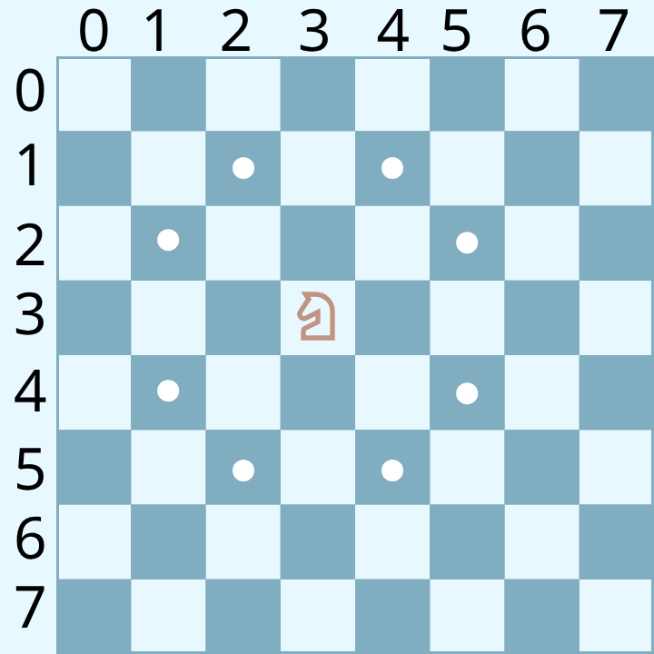
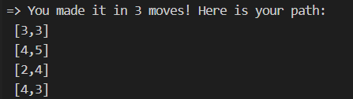

# Knights Travails

## Solution to the Knight Travails Problem

**Problem:** You have to find the shortest path for a Knight to reach a target square from a source square. Print the
path it followed to reach the destination from source.



## How to use this repo

-   Copy the repo url.
-   Open a terminal and change the directory to your desired folder.
-   Run the command -

```
git clone <repo url>
```

-   Now open the directory in a code editor.
-   In demo.js copy and paste the below line. You can replace `test` variable with any variable you like.

```
const test = knightMoves(source,target);
```

-   Replace the source and target to you desired coordinates. e.g.: `knightMoves([3,3],[4,3])`
-   Now copy and paste in `demo.js`

```
console.log(knightMoves(source,destination))
```

-   Now open the terminal in the current directory and run the command : `node demo.js`
-   You will get the shortest path in the terminal. It will look something like this : 
- You can change the source and destination in the `knightMoves()` function and run `node demo.js` to find shortest path for different source and destinations.


## About Solution

-   I used a graph data structure to solve the problem.
-   A node contains the following properties :

1. The value of the coordinate
2. An array containing all the connected coordinates
3. The previous/ parent coordinate

-   I used BFS search algorithm to find the shortest path between two coordinates.
